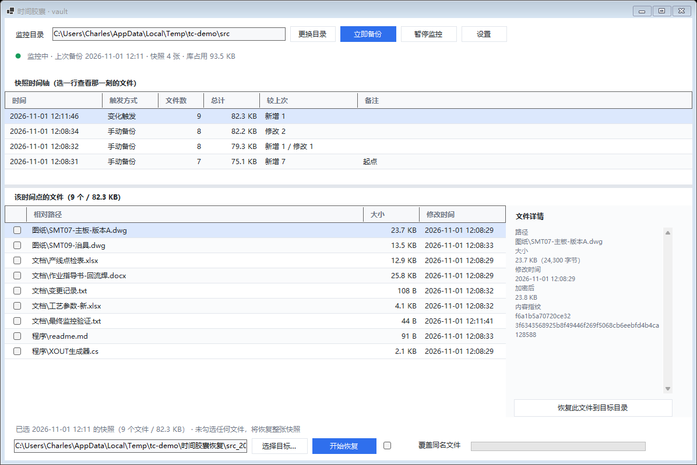
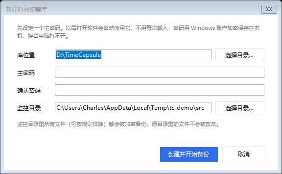
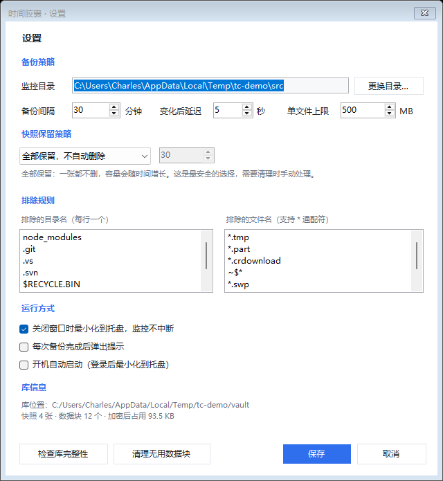

# 时间胶囊 · 目录备份加密工具

盯住一个目录，文件一变就把「那一刻整个目录的样子」拍成一张快照，每个文件单独 AES-256 加密存起来。
随时能翻回任意一个时间点，把当时的文件捞回来。

- 语言/框架：C# / .NET 8 / WinForms
- 依赖：**零第三方库**（加密、JSON、SQLite 都不需要，全用 .NET 内置）
- 目标系统：Windows 10 / 11 x64
- 当前版本：1.0.0
- 许可：MIT（见 [LICENSE](LICENSE)）

---

## 界面

主界面：上半是快照时间轴，下半是那一刻的文件清单，右边是选中文件的详情。



| 建库 / 解锁 | 设置 |
|---|---|
|  |  |

---

## 下载

到本仓库 **Releases** 下载 `TimeCapsule-win-x64.zip`，解压双击 `TimeCapsule.exe` 就能用——自包含包，目标机不用装 .NET。

想自己编译见文末「源码」一节。

---

## 一、怎么用

### 第一次

1. 双击 `TimeCapsule.exe`
2. 选备份库放哪（默认 `D:\TimeCapsule`，没有 D 盘就放「文档\时间胶囊库」）
3. 设一个主密码（至少 4 位）——**忘了就打不开，务必记牢**
4. 选要监控的目录
5. 点「创建并开始备份」

密码会用 Windows 账户的 DPAPI 加密后存在本机（`%APPDATA%\TimeCapsule\cred.dat`），以后打开软件自动使用，不用每次输入；拷到别的电脑或别的 Windows 账户下解不开。

### 日常

程序一直挂在托盘，文件一有变化就自动备份（默认等 5 秒合并连续写入，避免 Word 保存时一秒一张快照）。
另外每 30 分钟兜底全量扫一次（防 FileSystemWatcher 漏事件）。

- 顶栏状态点：绿=监控中，橙=正在备份，红=出错
- 「立即备份」：手动拍一张（内容没变化会提示，不会产生空快照）
- 「暂停监控」：暂停自动备份，手动备份仍可用

### 恢复（时间胶囊的核心）

1. 上半区「快照时间轴」点一个时间点 → 下半区列出那一刻的全部文件
2. 恢复范围：
   - 什么都不勾 = 恢复整张快照
   - 勾几个 = 只恢复勾选的文件（也可以在右侧详情栏点「恢复此文件到目标目录」）
3. 目标目录：默认自动填 `源目录同级\时间胶囊恢复\目录名_快照ID`，**不会碰原目录**
4. 「覆盖同名文件」默认关闭（目标已存在就跳过）；勾上后要先确认，被覆盖的旧文件会先移到 `库\trash\时间戳\` 里，可以找回
5. 恢复完会报成功/跳过/失败数量，可以一键打开目标目录

---

## 二、库长什么样

```
D:\TimeCapsule\
  vault.json                 配置（盐值、密码校验块、监控目录、策略）
  blobs\a3\a3f8c1...tcb       加密后的文件内容（按内容哈希命名，只增不改）
  snaps\20261101-115420\      每一次快照一个目录
    manifest.tcm              加密的文件清单
  trash\20261101-120000\      恢复时被覆盖的旧文件
  logs\backup-202611.log      运行日志（只记路径和结果，不记内容）
```

关键：**快照是全量的，存储是增量的**。改一个 10MB 的文档，新快照只多一个加密块，不会把整个目录再拷一遍。
同样的内容只存一份（按 SHA-256 去重）。

---

## 三、加密怎么做的

| 项目 | 做法 |
|---|---|
| 算法 | AES-256-GCM（带完整性校验，密文改一个字节就解不开） |
| 密钥 | 主密码 → PBKDF2-HMAC-SHA256（210,000 次迭代 + 32 字节随机盐） |
| 每个文件 | 独立的子密钥（主密钥 + 内容哈希派生）+ 随机 nonce |
| 大文件 | 按 1MB 分块流式加密，GB 级文件也只占 1MB 内存 |
| 清单 | 同样加密，文件路径不会以明文出现在磁盘上 |
| 密码存放 | Windows DPAPI（当前用户），不写明文 |

块文件格式：`TCV1`(4) + 版本(1) + 标志(1) + 保留(2) + 基础nonce(8) + 块大小(4) + 明文长度(8)，之后每块 `长度(4) + 密文 + 校验码(16)`。

---

## 四、命令行（可选，给脚本用）

```
TimeCapsule.exe --selftest <工作目录>            全流程自检（31 项）
TimeCapsule.exe --create <库目录> <密码> <监控目录>
TimeCapsule.exe --backup <库目录> <密码>
TimeCapsule.exe --list <库目录> <密码>
TimeCapsule.exe --info <库目录> <密码>
TimeCapsule.exe --restore <库目录> <密码> <快照ID> <目标目录> [--paths a;b] [--overwrite]
```

自检和界面自检只用于开发验证，日常用图形界面即可。

---

## 五、几个要提前知道的点

1. **密码忘了 = 数据没了**。没有后门、没有恢复码，这是加密的正常代价。
2. 库目录不要放在被监控目录里面（程序会自动跳过库本身，但整个磁盘误删时库也会没）。
3. 默认排除：`node_modules`、`.git`、`.vs`、`.svn`、`obj`、`$RECYCLE.BIN`、`System Volume Information`；文件名 `*.tmp`、`*.part`、`*.crdownload`、`~$*`、`*.swp`、`Thumbs.db`、`desktop.ini`。这些都能在设置里改。
4. 单文件默认上限 500MB，超过的跳过并在日志记一条（避免一个 ISO 拖垮整次备份）。
5. 保留策略默认「全部保留」；也可以改成按天数或按库容量上限自动清理（最新的那张永远保留）。
6. 设置里有「检查库完整性」：会把每个块解密一遍校验指纹，库大的时候慢，但能提前发现坏块。

---

## 六、在 Visual Studio 里改界面

工程是**标准 Designer.cs 分离**结构，三个窗体都能用 VS 设计器打开、拖控件、改属性：

```
src/TimeCapsule.sln          ← 双击用 VS 打开
src/TimeCapsule/UI/
  FrmMain.cs / FrmMain.Designer.cs              主界面
  FrmVaultDialog.cs / FrmVaultDialog.Designer.cs 建库/解锁
  FrmSettings.cs / FrmSettings.Designer.cs       设置
```

三条约定，改界面时注意：

1. **布局只在 Designer.cs 里**。控件位置、大小、字体、颜色、Anchor 全在 InitializeComponent，
   设计器里拖完保存就生效；代码里不再有第二套排版（以前的 LayoutChrome 已经删掉）。
2. **自适应靠 Anchor**：顶栏按钮锚 Top|Right（跟着右边界走），监控目录框和底栏进度条锚 Top|Left|Right（跟着拉伸），
   两个表格和顶部/底部条用 Dock。改布局时别删这些 Anchor。
3. **窗体都有 public 无参构造函数**，构造里不做重活（读库、启动监控都放在 AttachVault/OnLoad），
   所以设计器能实例化。

例外（这些故意留在代码里，不在 Designer 里）：

- `UiTheme.StyleGrid()` —— DataGridView 的统一皮肤（行高、表头配色、隔行变色），一处改全局生效；
- `FrmVaultDialog` 的「打开库」模式比「新建」矮一截，运行时在 OnLoad 里收一下（设计器里看到的是「新建」模式）；
- 托盘图标、状态圆点自绘。

自检命令（不用开 VS 就能确认设计器还能打开）：

```
TimeCapsule.exe --designcheck    # 无参构造 / 实例化 / 控件树 / InitializeComponent
TimeCapsule.exe --geom <库> <密码>   # 三种窗口尺寸下的控件重叠与越界
```

---

## 七、源码

```
src/TimeCapsule.sln
src/TimeCapsule/TimeCapsule.csproj
  Core/            加密、库、快照、备份、恢复、监控、日志、自检
    Crypto.cs          AES-256-GCM 分块加解密
    Vault.cs           库配置与主密钥
    BlobStore.cs       内容寻址的加密块仓库
    SnapshotStore.cs   快照清单读写 + 保留策略
    BackupEngine.cs    扫描 → 去重 → 加密 → 生成快照
    RestoreEngine.cs   解密恢复（防路径穿越、防覆盖）
    FolderMonitor.cs   FileSystemWatcher + 防抖 + 定时兜底
    CredentialStore.cs DPAPI 记住密码
    SelfTest.cs        31 项全流程自检
  UI/              主界面、建库窗口、设置窗口（标准 Designer 分离）
tools/
  demo-setup.py      造演示数据（开发用）
  demo-rebuild.py    重建三张快照的演示库（出截图用）
  package.py         打 zip
publish.sh           一键出包脚本（Windows Git Bash 下跑）
docs/
  设计方案.md         设计稿与实现差异说明
  screenshots/       界面截图
.github/workflows/build.yml   CI：编译 + 自检 + 发布 Release
```

代码约 4900 行，无第三方依赖。

环境要求：**.NET 8 SDK**（编译） / **Windows 10、11 x64**（运行）。

编译：

```
cd src/TimeCapsule
dotnet build -c Release
```

出包（自包含，目标机不用装 .NET）：

```
dotnet publish -c Release -r win-x64 --self-contained true -p:PublishReadyToRun=false
```

或者直接跑 `./publish.sh`，它会编译 → 发布 → 跑自检 → 打包到 `dist/`。

---

## 八、许可

MIT License，见 [LICENSE](LICENSE)。

